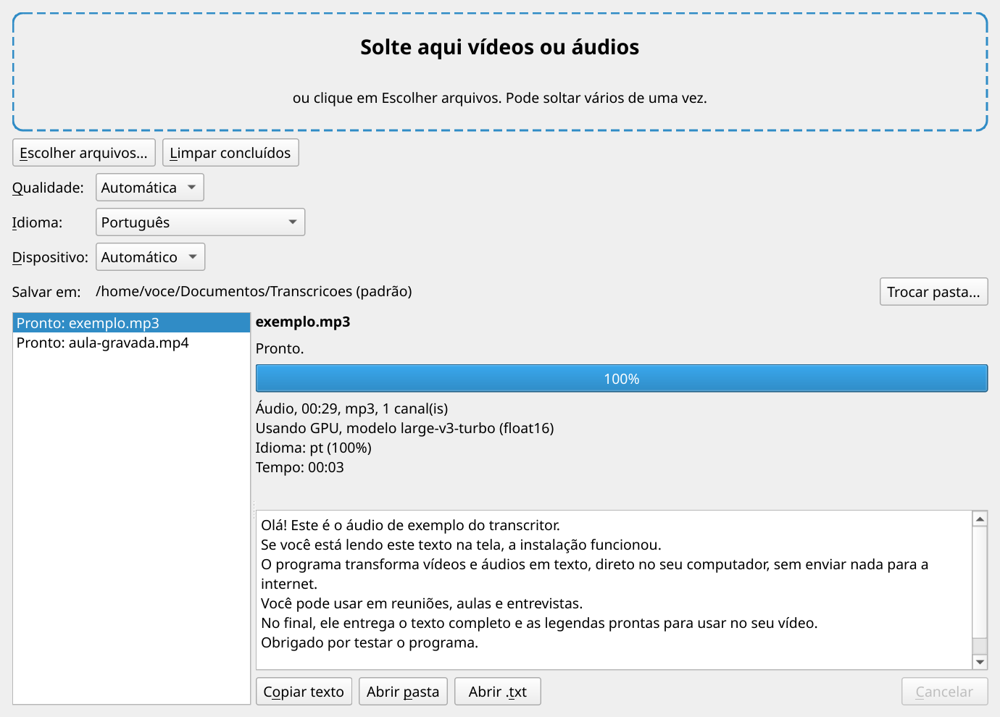
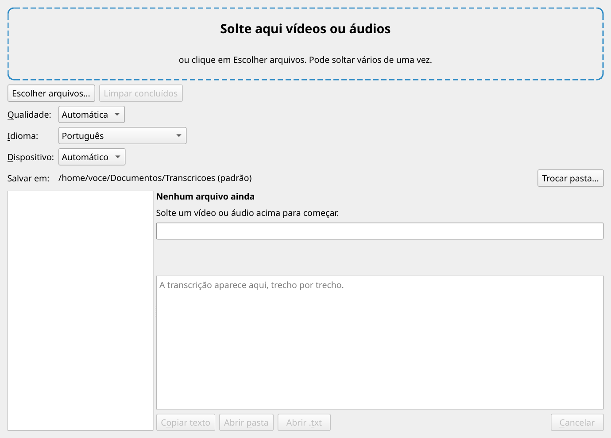
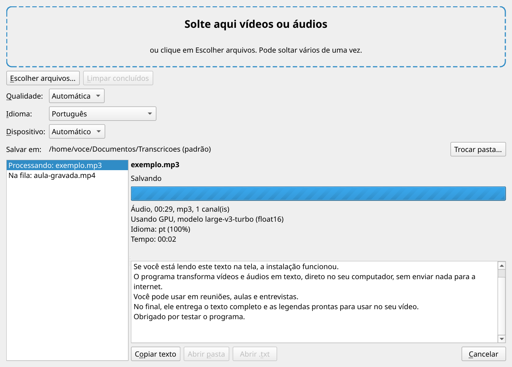

<div align="center">


# Transcritor

**Transforme vídeos e áudios em texto, no seu próprio computador.**

De graça, sem cadastro e sem enviar nada para a internet.

[](https://github.com/RafaTheMonk/transcritor/actions/workflows/testes.yml)
[](LICENSE)


[Passo a passo](#passo-a-passo) | [Perguntas frequentes](#perguntas-frequentes) | [Problemas comuns](#problemas-comuns)



</div>

## Para que serve

Gravou uma reunião, uma aula ou uma entrevista e precisa do texto? Solte o arquivo na janela e pronto.

- **Privado:** tudo acontece no seu computador. Seu áudio não vai para nenhum servidor.
- **Vídeo ou áudio:** o programa descobre sozinho. Se for vídeo, separa o áudio e guarda para você.
- **Legendas prontas:** além do texto, gera arquivos `.srt` e `.vtt` para usar em vídeos.
- **Vários de uma vez:** solte vários arquivos e eles entram numa fila.
- **Funciona sem placa de vídeo:** com placa NVIDIA fica bem mais rápido, mas ela não é obrigatória.
- **Em português por padrão:** também reconhece inglês e espanhol e pode detectar o idioma sozinho.

**Quanto tempo leva?** Um vídeo de cerca de 5 minutos, com as opções padrão:

| Computador usado no teste | Tempo |
|---|---|
| Com placa NVIDIA RTX 3050 de 6 GB | cerca de 13 segundos |
| Só com o processador (Intel Core i5-13420H) | cerca de 1 minuto |

## Do que você precisa

- **Linux.** Por enquanto, o Transcritor não funciona no Windows nem no Mac.
- **Espaço em disco:** cerca de 2,5 GB, ou 4,5 GB se você tiver placa NVIDIA.
- **Internet** só para instalar e na primeira transcrição, quando ele baixa o modelo de reconhecimento de voz. Depois funciona desconectado.

| Sistema | Situação |
|---|---|
| Arch, CachyOS e derivados | testado no CachyOS com KDE |
| Ubuntu | testes automáticos a cada mudança |
| Debian, Mint, Pop!_OS, Fedora, openSUSE | deve funcionar, ainda sem teste |
| Windows, macOS | ainda não |

## Passo a passo

Você vai usar o terminal só na instalação. Depois disso, tudo é pela janela do programa.

### 1. Abra o terminal

Procure por **Terminal** ou **Konsole** no menu de aplicativos. No Ubuntu, o atalho é `Ctrl` + `Alt` + `T`.

Para colar um comando no terminal, use `Ctrl` + `Shift` + `V` e aperte `Enter`. Quando pedir senha, digite a do seu computador. As letras não aparecem enquanto você digita, isso é normal.

### 2. Instale o que o sistema precisa

Use só o comando da sua distribuição. Se ele perguntar se quer continuar, digite `s` ou `y`, o que a pergunta mostrar, e aperte `Enter`.

**Ubuntu, Mint, Debian, Pop!_OS**

```bash
sudo apt install git ffmpeg python3-venv libxcb-cursor0
```

**Fedora**

```bash
sudo dnf install git ffmpeg-free python3
```

**Arch, CachyOS, Manjaro**

```bash
sudo pacman -S --needed git ffmpeg python
```

**openSUSE**

```bash
sudo zypper install git ffmpeg python3
```

### 3. Baixe e instale o Transcritor

Copie os três comandos de uma vez, cole no terminal e aperte `Enter`:

```bash
git clone https://github.com/RafaTheMonk/transcritor.git ~/transcritor
cd ~/transcritor
bash instalar.sh
```

A instalação leva alguns minutos. Quando terminar, vai aparecer a mensagem **Pronto!**. Ela não pede senha nem mexe no sistema: o programa fica na pasta `transcritor`, dentro da sua pasta pessoal.

<details>
<summary>Prefere baixar sem usar o git?</summary>

1. No topo desta página, clique no botão verde **Code** e depois em **Download ZIP**.
2. Extraia o arquivo na sua pasta pessoal.
3. Abra o terminal na pasta extraída e rode `bash instalar.sh`.

</details>

### 4. Abra o programa

Procure por **Transcritor** no menu de aplicativos. Se ele não aparecer de imediato, saia da sessão e entre de novo.

<div align="center">

</div>

### 5. Faça o primeiro teste

Clique em **Escolher arquivos** e abra o áudio de exemplo, que está em `transcritor/exemplos/exemplo.mp3`. Ou arraste um vídeo ou áudio seu para a janela.

Na primeira vez, o programa baixa o modelo, cerca de 1,6 GB. Isso só acontece uma vez. O texto vai aparecendo na tela enquanto ele trabalha:

<div align="center">

</div>

### 6. Pegue o resultado

Quando terminar, use os botões **Copiar texto**, **Abrir pasta** ou **Abrir .txt**.

Os arquivos ficam em `Documentos/Transcricoes`, com uma pasta para cada transcrição:

| Arquivo | Para que serve |
|---|---|
| `.txt` | o texto, para ler e editar |
| `.srt` e `.vtt` | legendas com o tempo de cada fala, para usar em vídeos |
| `.json` | os mesmos dados, para quem programa |
| `.m4a` (ou outro formato de áudio) | o áudio separado, quando o arquivo era vídeo |

Transcrição anterior nunca é apagada: se o nome se repetir, a pasta nova ganha `-2`, `-3` e assim por diante.

## Qual qualidade escolher

Deixe em **Automática**, que já é a melhor opção na maioria dos casos. Se quiser testar:

| Opção | Tamanho do modelo | Quando usar |
|---|---|---|
| **Automática** ou **Equilibrada** | 1,6 GB | quase sempre |
| **Rápida** | 0,5 GB | computador fraco ou quando só precisa de uma ideia geral do conteúdo, erra bem mais |
| **Máxima** | 3,1 GB | áudio difícil, para comparar. Leva quase 3 vezes mais tempo e, no nosso teste, não superou a Automática |

Essa comparação vem de um único vídeo em português. Com outro tipo de áudio, o resultado pode mudar.

## Perguntas frequentes

**É de graça mesmo?**
Sim. O código é aberto, sob a [licença MIT](LICENSE), e não há limite de uso.

**Meu áudio vai para algum lugar?**
Não. A internet só é usada para baixar o modelo na primeira vez. Depois disso, o programa funciona até com a internet desligada, e conferimos que ele não abre nenhuma conexão durante a transcrição.

**O texto sai perfeito?**
Não. Costuma acertar bem a fala comum, mas erra nomes próprios e termos técnicos. Revise antes de publicar ou de usar em algo importante. Áudio com ruído ou várias pessoas falando juntas também piora o resultado.

**Ele separa quem está falando?**
Não. O texto sai corrido, sem identificar as pessoas.

**Quais formatos ele aceita?**
Os que o FFmpeg lê, como MP4, MOV, MKV, MP3, M4A, WAV e OGG, que é o formato dos áudios do WhatsApp. Se o arquivo tiver som, é bem provável que funcione.

**Tenho placa AMD ou Intel. Funciona?**
Funciona, mas usando o processador, porque a aceleração aqui é só para NVIDIA.

**Como atualizo para a versão mais nova?**

```bash
cd ~/transcritor
git pull
bash instalar.sh
```

**Como desinstalo?**

```bash
bash ~/transcritor/desinstalar.sh
```

Suas transcrições continuam guardadas. Depois, é só apagar a pasta `transcritor`. A mensagem no final explica como liberar também o espaço dos modelos.

## Problemas comuns

| O que aparece | O que fazer |
|---|---|
| `falta no seu sistema: ffmpeg` ou `python3-venv` | Rode o comando que a própria mensagem indica e depois `bash instalar.sh` de novo. |
| `transcritor: comando não encontrado` | Feche e abra o terminal, ou use o atalho no menu de aplicativos. |
| A janela não abre no Ubuntu | Rode `sudo apt install libxcb-cursor0`. |
| O atalho do menu parou de funcionar | Você mudou a pasta de lugar. Rode `bash instalar.sh` na pasta nova. |
| Tenho placa NVIDIA, mas está usando o processador | Rode `nvidia-smi`. Se der erro, o driver da placa não está instalado. Se funcionar, rode `bash instalar.sh` de novo. |
| `sem_audio` ou "não tem áudio" | O arquivo não tem nenhuma faixa de som. |
| Download do modelo falhou | Confira a internet e tente de novo. Ele só precisa baixar uma vez. |

Não resolveu? [Abra uma issue](https://github.com/RafaTheMonk/transcritor/issues/new/choose) contando o que aconteceu.

## Para quem gosta de terminal

```bash
transcrever video.mov
transcrever aula.mp4 entrevista.mp3 --idioma auto
transcrever reuniao.m4a --formatos txt,srt --saida ~/Documentos/reunioes
```

Todas as opções, a arquitetura e como rodar os testes estão em [docs/para-desenvolvedores.md](docs/para-desenvolvedores.md).

## Como contribuir

Relatos de problema e sugestões são bem-vindos. Um bom ponto de partida é testar em outra distribuição e contar como foi. Veja [CONTRIBUTING.md](CONTRIBUTING.md).

## Créditos

O Transcritor junta projetos abertos muito bons:

- [faster-whisper](https://github.com/SYSTRAN/faster-whisper) e [CTranslate2](https://github.com/OpenNMT/CTranslate2) (MIT), que rodam o reconhecimento de voz
- [Whisper](https://github.com/openai/whisper), da OpenAI (MIT), os modelos de reconhecimento
- [FFmpeg](https://ffmpeg.org) (LGPL/GPL), que lê os arquivos e separa o áudio, instalado à parte pelo sistema
- [PySide6](https://doc.qt.io/qtforpython-6/) (LGPL), a interface gráfica

As bibliotecas CUDA da NVIDIA, baixadas só em computadores com placa NVIDIA, têm licença própria da NVIDIA.

## Licença

[MIT](LICENSE). Pode usar, modificar e distribuir, inclusive em projetos comerciais.

Feito por [Rafael Brito](https://github.com/RafaTheMonk).
